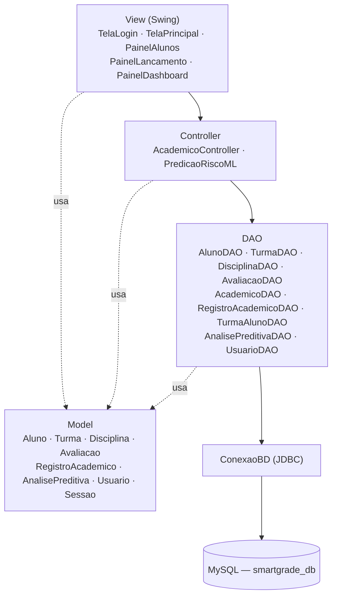
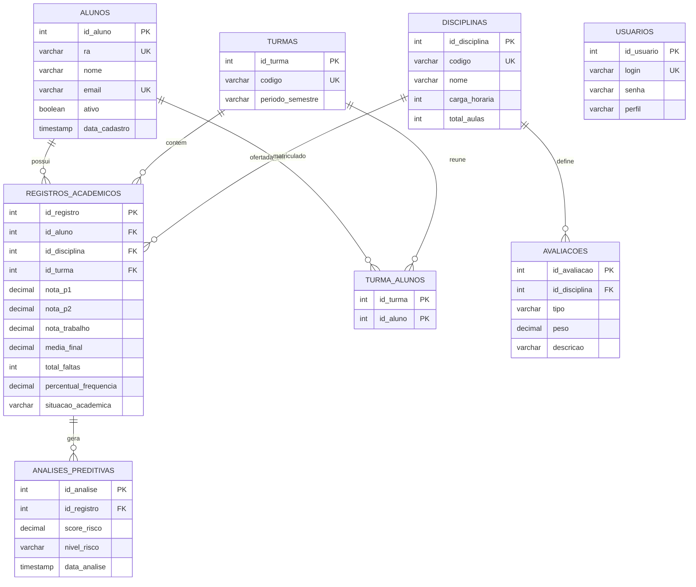

# SmartGrade — Documentação Técnica

**Sistema de Gestão Acadêmica Inteligente**
Versão 1.0 · Outubro de 2026

---

## Sumário

1. [Introdução](#1-introdução)
2. [Requisitos e cobertura](#2-requisitos-e-cobertura)
3. [Perfis de acesso e casos de uso](#3-perfis-de-acesso-e-casos-de-uso)
4. [Arquitetura](#4-arquitetura)
5. [Modelo de dados](#5-modelo-de-dados)
6. [Regras de negócio](#6-regras-de-negócio)
7. [Módulo preditivo de risco](#7-módulo-preditivo-de-risco)
8. [Descrição das classes](#8-descrição-das-classes)
9. [Instalação e execução](#9-instalação-e-execução)
10. [Testes](#10-testes)
11. [Limitações e melhorias futuras](#11-limitações-e-melhorias-futuras)
12. [Anexos](#12-anexos)

---

## 1. Introdução

### 1.1 Problema

O acompanhamento de notas e frequência costuma ser feito de forma manual ou dispersa, e os alunos em risco de reprovação são identificados tarde demais para uma intervenção pedagógica eficaz.

### 1.2 Solução

O **SmartGrade** é um sistema desktop de gestão acadêmica que centraliza notas, faltas e situação do aluno, calcula automaticamente média ponderada, frequência e situação acadêmica, e classifica o risco de reprovação em **Baixo**, **Médio** ou **Alto** por meio de um módulo preditivo.

### 1.3 Escopo desta versão

- Cadastro e listagem de alunos, com exclusão lógica.
- Lançamento e edição de notas (P1, P2 e Trabalho) e faltas por turma e disciplina.
- Cálculo automático de média final, percentual de frequência e situação acadêmica.
- Classificação de risco a cada lançamento, com histórico das análises.
- Dashboard com indicadores e lista de casos que exigem atenção pedagógica.
- Autenticação e controle de acesso por perfil (Aluno, Professor e Coordenador).

### 1.4 Tecnologias

| Item | Tecnologia |
|---|---|
| Linguagem | Java (JDK 21) |
| Interface | Java Swing |
| Banco de dados | MySQL 8.0 ou superior (InnoDB) |
| Acesso a dados | JDBC com `mysql-connector-j` |
| Arquitetura | MVC com padrão DAO |

---

## 2. Requisitos e cobertura

Os requisitos completos estão em `docs/requisitos/requisitos-funcionais.md` (RF01–RF75) e `docs/requisitos/requisitos-nao-funcionais.md` (RNF01–RNF29). A tabela abaixo resume o estado de cada módulo nesta versão.

### 2.1 Requisitos funcionais

| Módulo | RFs | Estado | Observação |
|---|---|---|---|
| Gestão de Alunos | RF01–RF08 | Parcial | Cadastro, listagem e exclusão lógica. RA e e-mail são únicos. Sem busca, edição em tela, ficha detalhada e histórico. |
| Gestão de Turmas | RF09–RF16 | Parcial | Camada de dados (CRUD e matrícula) implementada nos DAOs; carga via `seed.sql`. Sem telas de cadastro. |
| Gestão de Disciplinas | RF17–RF23 | Parcial | Camada de dados implementada; sem telas e sem vínculo disciplina–turma explícito. |
| Avaliações e Notas | RF24–RF33 | Parcial | Lançamento e alteração de P1, P2 e Trabalho, média ponderada recalculada ao salvar e validação de escala na edição. Cadastro de avaliações sem tela. |
| Frequência | RF34–RF40 | Parcial | Registro do total de faltas por disciplina e percentual de frequência. Sem chamada por aula e sem sinalização visual de limite. |
| Situação Acadêmica | RF41–RF47 | Implementado | Aprovado, Exame, Reprovado por Nota, Reprovado por Falta e Cursando, reavaliados a cada salvamento. Sem exportação. |
| Módulo Preditivo | RF48–RF58 | Parcial | Score e classificação em três faixas, histórico gravado em banco. Modelo por regra ponderada, sem treinamento. |
| Dashboard | RF59–RF66 | Parcial | Indicadores (total de alunos, média geral, casos de alto e médio risco) e tabela de risco. Sem gráficos. |
| Alertas | RF67–RF70 | Não implementado | Apenas o destaque no dashboard. |
| Relatórios | RF71–RF75 | Não implementado | — |

### 2.2 Requisitos não funcionais

| Tema | RNFs | Estado |
|---|---|---|
| Segurança — SQL Injection | RNF07 | Atendido: todas as consultas usam `PreparedStatement`. |
| Segurança — RBAC | RNF05 | Parcial: menus por perfil via `Sessao` (ver seção 3). |
| Segurança — hash de senha | RNF06 | Não atendido: senha armazenada em texto puro. |
| Integridade — unicidade | RNF09 | Atendido: `UNIQUE` em RA, e-mail e códigos. |
| Integridade — chaves estrangeiras | RNF08 | Parcial: FKs presentes, com `ON DELETE CASCADE` em vez de `RESTRICT`. |
| Integridade — transações | RNF10 | Não atendido. |
| Confiabilidade | RNF20, RNF21 | Atendido: tratamento de `SQLException` e engine InnoDB. |
| Arquitetura | RNF14, RNF15, RNF16 | Parcial: MVC e convenções Java respeitados; pacotes sem prefixo `com.smartgrade`; alguns painéis acessam DAOs diretamente. |
| Compatibilidade | RNF17–RNF19 | Atendido: Java 21, aplicação multiplataforma e MySQL 8. |
| Usabilidade | RNF11–RNF13 | Não atendido: sem Look and Feel moderno, atalhos ou máscaras. |
| Escalabilidade / ML | RNF22, RNF23, RNF26, RNF27 | Não atendido ou não medido. |
| Documentação | RNF28, RNF29 | Atendido: este documento, `schema.sql` e `seed.sql`. |

---

## 3. Perfis de acesso e casos de uso

O diagrama de casos de uso está em `docs/diagramas/Casos_de_Uso_-_SmartGrade_drawio.png`.

### 3.1 Atores

| Ator | Responsabilidade |
|---|---|
| Coordenador | Mantém alunos, turmas e disciplinas; visualiza dashboard e relatórios. |
| Professor | Lança notas e avaliações; registra frequência. |
| Aluno | Visualiza o boletim e recebe o alerta de alto risco. |
| Módulo Preditivo | Ator de sistema que processa a análise de risco. |

### 3.2 Relações entre casos de uso

- **Lançar Notas e Avaliações** inclui *Calcular Média Ponderada* e *Processar Análise Preditiva de Risco*.
- **Registrar Frequência** inclui *Calcular Percentual de Faltas*.
- **Disparar Alerta de Alto Risco** estende *Processar Análise Preditiva de Risco*.

### 3.3 Controle de acesso implementado

O perfil é lido do banco no login (`UsuarioDAO.autenticar`), guardado em `Sessao.perfilLogado` e usado pela `TelaPrincipal` para decidir quais botões são exibidos.

| Perfil | Alunos | Lançamento | Dashboard & Risco | Tela inicial |
|---|---|---|---|---|
| COORDENADOR | Sim | Sim | Sim | Alunos |
| PROFESSOR | Não | Sim | Sim | Lançamento |
| ALUNO | Não | Sim | Não | Lançamento |

> Esta é uma proteção de interface. A limitação correspondente está descrita na seção 11.

---

## 4. Arquitetura

O sistema segue o padrão **MVC** combinado com **DAO**. Cada camada só conversa com a camada imediatamente abaixo.



### 4.1 Estrutura do repositório

| Caminho | Conteúdo |
|---|---|
| `src/` | Código-fonte (pacotes `conexao`, `controller`, `dao`, `model`, `view`) |
| `database/` | `schema.sql` (estrutura) e `seed.sql` (dados de exemplo) |
| `docs/diagramas/` | Diagramas de casos de uso e de classes |
| `docs/regras_de_negocio/` | `regras-negocio.md` |
| `docs/requisitos/` | Requisitos funcionais e não funcionais |
| `lib/` | Dependências externas (`mysql-connector-j`) |

### 4.2 Responsabilidade dos pacotes

| Pacote | Responsabilidade |
|---|---|
| `conexao` | Abertura de conexões JDBC com o MySQL. |
| `model` | Entidades de domínio e regras de cálculo do registro acadêmico. |
| `dao` | Acesso a dados: execução das consultas SQL. |
| `controller` | Orquestração entre a interface e os dados; regras do dashboard e da predição. |
| `view` | Telas Swing e captura das interações do usuário. |

### 4.3 Fluxo principal: lançamento de notas

1. O professor seleciona turma e disciplina e clica em **Carregar Alunos**.
2. O `PainelLancamento` busca os registros via `AcademicoController.buscarRegistros`.
3. O professor altera notas e faltas e clica em **Salvar Lançamentos e Avaliar Risco** (ou usa **Editar Nota/Falta**).
4. Para cada registro, o painel chama `calcularMediaPonderada()`, `calcularFrequencia(totalAulas)` e `atualizarSituacao()`.
5. `AcademicoController.processarLancamento` grava o registro pelo `AcademicoDAO`.
6. O `PredicaoRiscoML` classifica o risco e o `AnalisePreditivaDAO` grava a análise com data e hora.
7. O `PainelDashboard` consulta os registros e as classificações na próxima atualização.

---

## 5. Modelo de dados

O script oficial da estrutura é `database/schema.sql`. Os dados de exemplo estão em `database/seed.sql`.

### 5.1 Diagrama entidade-relacionamento



Cardinalidades: a relação Registro Acadêmico → Análise Preditiva é **1:N**, pois cada salvamento gera uma nova análise e o histórico é mantido (RN47).

### 5.2 Dicionário de dados

#### `alunos`

| Coluna | Tipo | Restrição | Descrição |
|---|---|---|---|
| id_aluno | INT | PK, AUTO_INCREMENT | Identificador interno |
| ra | VARCHAR(20) | NOT NULL, UNIQUE | Registro acadêmico (RN01) |
| nome | VARCHAR(100) | NOT NULL | Nome completo |
| email | VARCHAR(100) | NOT NULL, UNIQUE | E-mail institucional (RN02) |
| ativo | BOOLEAN | NOT NULL, DEFAULT TRUE | Exclusão lógica (RN06) |
| data_cadastro | TIMESTAMP | DEFAULT CURRENT_TIMESTAMP | Data de criação |

#### `turmas`

| Coluna | Tipo | Restrição | Descrição |
|---|---|---|---|
| id_turma | INT | PK, AUTO_INCREMENT | Identificador interno |
| codigo | VARCHAR(20) | NOT NULL, UNIQUE | Código da turma (RN03) |
| periodo_semestre | VARCHAR(10) | NOT NULL | Período letivo, por exemplo `2026.2` |

#### `disciplinas`

| Coluna | Tipo | Restrição | Descrição |
|---|---|---|---|
| id_disciplina | INT | PK, AUTO_INCREMENT | Identificador interno |
| codigo | VARCHAR(20) | NOT NULL, UNIQUE | Código curricular (RN04) |
| nome | VARCHAR(100) | NOT NULL | Nome da disciplina |
| carga_horaria | INT | NOT NULL | Carga horária em horas |
| total_aulas | INT | NOT NULL | Total de aulas, base do cálculo de frequência (RN25) |

#### `turma_alunos` (associativa N:N)

| Coluna | Tipo | Restrição | Descrição |
|---|---|---|---|
| id_turma | INT | PK, FK → turmas | Turma |
| id_aluno | INT | PK, FK → alunos | Aluno matriculado |

A chave primária composta impede matrícula duplicada na mesma turma (RN08).

#### `avaliacoes`

| Coluna | Tipo | Restrição | Descrição |
|---|---|---|---|
| id_avaliacao | INT | PK, AUTO_INCREMENT | Identificador interno |
| id_disciplina | INT | NOT NULL, FK → disciplinas | Disciplina da avaliação (RN12) |
| tipo | VARCHAR(50) | NOT NULL | Prova, Trabalho ou Atividade (RN13) |
| peso | DECIMAL(3,2) | NOT NULL | Peso no cálculo da média (RN14) |
| descricao | VARCHAR(255) | — | Descrição identificadora |

#### `registros_academicos`

| Coluna | Tipo | Restrição | Descrição |
|---|---|---|---|
| id_registro | INT | PK, AUTO_INCREMENT | Identificador interno |
| id_aluno | INT | NOT NULL, FK → alunos | Aluno |
| id_disciplina | INT | NOT NULL, FK → disciplinas | Disciplina |
| id_turma | INT | NOT NULL, FK → turmas | Turma |
| nota_p1 | DECIMAL(4,2) | DEFAULT 0.00 | Nota da P1 |
| nota_p2 | DECIMAL(4,2) | DEFAULT 0.00 | Nota da P2 |
| nota_trabalho | DECIMAL(4,2) | DEFAULT 0.00 | Nota do trabalho |
| media_final | DECIMAL(4,2) | DEFAULT 0.00 | Média ponderada (RN21) |
| total_faltas | INT | DEFAULT 0 | Faltas acumuladas na disciplina |
| percentual_frequencia | DECIMAL(5,2) | DEFAULT 100.00 | Frequência em % (RN25) |
| situacao_academica | VARCHAR(30) | DEFAULT 'Cursando' | Situação oficial (RN31–RN36) |

Restrição `uk_aluno_disc_turma`: `UNIQUE (id_aluno, id_disciplina, id_turma)`, que garante um único registro por aluno, disciplina e turma (RN11).

#### `analises_preditivas`

| Coluna | Tipo | Restrição | Descrição |
|---|---|---|---|
| id_analise | INT | PK, AUTO_INCREMENT | Identificador interno |
| id_registro | INT | NOT NULL, FK → registros_academicos | Registro analisado |
| score_risco | DECIMAL(4,3) | NOT NULL | Score entre 0,000 e 1,000 (RN41) |
| nivel_risco | VARCHAR(20) | NOT NULL | Classificação (`BAIXO`, `MEDIO` ou `ALTO`, conforme gravado pelo sistema) |
| data_analise | TIMESTAMP | DEFAULT CURRENT_TIMESTAMP | Data e hora da análise (RN47) |

#### `usuarios`

| Coluna | Tipo | Restrição | Descrição |
|---|---|---|---|
| id_usuario | INT | PK, AUTO_INCREMENT | Identificador interno |
| login | VARCHAR(50) | NOT NULL, UNIQUE | Login de acesso |
| senha | VARCHAR(100) | NOT NULL | Senha (texto puro nesta versão) |
| perfil | VARCHAR(20) | NOT NULL | `ALUNO`, `PROFESSOR` ou `COORDENADOR` |

---

## 6. Regras de negócio

O texto completo das regras está em `docs/regras_de_negocio/regras-negocio.md`. A tabela abaixo mostra onde cada grupo de regras é aplicado.

### 6.1 Rastreabilidade

| Regra | Descrição resumida | Onde é aplicada |
|---|---|---|
| RN01, RN02 | RA e e-mail únicos | `UNIQUE` em `alunos` |
| RN03, RN04 | Código único de turma e disciplina | `UNIQUE` em `turmas` e `disciplinas` |
| RN05 | Dados obrigatórios | `NOT NULL` no schema e validação em `AcademicoController.salvarAluno` |
| RN06 | Preservação do histórico | Exclusão lógica em `alunos` (`ativo`); demais entidades: ver seção 11 |
| RN07, RN08 | Matrícula única por turma | PK composta de `turma_alunos` |
| RN10 | Registro depende de aluno, disciplina e turma | FKs em `registros_academicos` |
| RN11 | Um registro por aluno, disciplina e turma | `uk_aluno_disc_turma` |
| RN12–RN14 | Avaliação vinculada à disciplina, com tipo e peso | Tabela `avaliacoes` |
| RN16, RN17 | Escala de 0 a 10 | `DECIMAL(4,2)` e validação no diálogo de edição do `PainelLancamento` |
| RN19, RN37, RN46 | Recálculo ao alterar notas ou faltas | Cálculos executados antes de `processarLancamento` |
| RN20–RN22 | Média ponderada com duas casas | `RegistroAcademico.calcularMediaPonderada()` |
| RN24, RN25 | Frequência pelo total de aulas da disciplina | `RegistroAcademico.calcularFrequencia(totalAulas)` |
| RN26, RN27, RN30–RN35 | Situação acadêmica | `RegistroAcademico.atualizarSituacao()` |
| RN36 | Estado inicial "Cursando" | `DEFAULT 'Cursando'` |
| RN41–RN45 | Score e faixas de risco | `PredicaoRiscoML.classificarRisco()` |
| RN47 | Histórico de análises | `analises_preditivas` com `data_analise` |
| RN48 | Predição não altera a situação oficial | A situação vem apenas de nota e frequência |

### 6.2 Média final (RN20–RN22)

```
Média Final = (P1 × 0,30) + (P2 × 0,40) + (Trabalho × 0,30)
```

Arredondamento para duas casas decimais (`HALF_UP`), aplicado somente ao resultado final, sem alterar as notas individuais.

### 6.3 Frequência (RN25)

```
Frequência (%) = ((Total de aulas − Total de faltas) / Total de aulas) × 100
```

O total de aulas é o campo `total_aulas` da disciplina. O valor mínimo é 0%.

### 6.4 Situação acadêmica (RN30–RN36)

A regra de falta tem precedência sobre as regras de nota (RN35).

| Ordem | Condição | Situação |
|---|---|---|
| 1 | Frequência < 75% | Reprovado por Falta |
| 2 | Média ≥ 7,00 | Aprovado |
| 3 | 5,00 ≤ Média < 7,00 | Exame |
| 4 | Média < 5,00 | Reprovado por Nota |
| — | Sem dados concluídos | Cursando |

---

## 7. Módulo preditivo de risco

O módulo é implementado pela classe `PredicaoRiscoML` e classifica o risco de reprovação de cada registro acadêmico. É uma ferramenta de apoio pedagógico e **não altera a situação oficial do aluno** (RN48, RN49).

### 7.1 Cálculo do score

```
riscoNota       = (10 − média) / 10
riscoFrequencia = (100 − frequência) / 100
score           = 0,6 × riscoNota + 0,4 × riscoFrequencia     (limitado a 0,000–1,000)
```

O peso de 60% para nota e 40% para frequência é uma ponderação definida no projeto.

### 7.2 Faixas de classificação (RN42–RN45)

| Score | Nível | Tratamento no sistema |
|---|---|---|
| 0,00 a 0,39 | BAIXO | Situação estável; não aparece na tabela de atenção |
| 0,40 a 0,69 | MEDIO | Aparece na tabela do dashboard (monitoramento preventivo) |
| 0,70 a 1,00 | ALTO | Aparece na tabela do dashboard (acompanhamento imediato) |

### 7.3 Exemplos

| Média | Frequência | Cálculo | Score | Nível |
|---|---|---|---|---|
| 8,0 | 95% | 0,6 × 0,2 + 0,4 × 0,05 | 0,140 | BAIXO |
| 4,0 | 70% | 0,6 × 0,6 + 0,4 × 0,3 | 0,480 | MEDIO |
| 1,0 | 50% | 0,6 × 0,9 + 0,4 × 0,5 | 0,740 | ALTO |

### 7.4 Dashboard

O `AcademicoController.carregarDashboard()` percorre todas as turmas e disciplinas cadastradas e produz:

- total de alunos ativos;
- média geral das médias finais;
- contador de casos de alto risco e contador de casos de médio risco;
- lista de casos de atenção (alto e médio) com média, frequência, nível e recomendação.

---

## 8. Descrição das classes

O diagrama de classes está em `docs/diagramas/Diagrama_de_Classes_-_SmartGrade_drawio.png`.

### 8.1 Pacote `conexao`

| Classe | Responsabilidade |
|---|---|
| `ConexaoBD` | Fornece conexões JDBC com o `smartgrade_db`. A senha do MySQL é lida da variável de ambiente `DB_PASSWORD`. |
| `TesteConexao` | Programa utilitário que verifica se a conexão com o banco funciona. |

### 8.2 Pacote `model`

| Classe | Responsabilidade |
|---|---|
| `Aluno` | Entidade de aluno (id, RA, nome, e-mail). |
| `Turma` | Entidade de turma (id, código, período). |
| `Disciplina` | Entidade de disciplina (código, nome, carga horária, total de aulas). |
| `Avaliacao` | Entidade de avaliação (disciplina, tipo, peso, descrição). |
| `RegistroAcademico` | Notas, faltas, média, frequência e situação de um aluno em uma disciplina e turma; contém `calcularMediaPonderada()`, `calcularFrequencia(int)` e `atualizarSituacao()`. |
| `AnalisePreditiva` | Resultado de uma análise de risco (score, nível, data). |
| `Usuario` | Usuário autenticado, com seu perfil. |
| `Sessao` | Guarda o perfil do usuário logado durante a execução. |

### 8.3 Pacote `dao`

| Classe | Responsabilidade |
|---|---|
| `AlunoDAO` | Cadastro (com reativação por RA), listagem de ativos, atualização e exclusão lógica de alunos. |
| `TurmaDAO` | CRUD de turmas. |
| `DisciplinaDAO` | CRUD de disciplinas. |
| `AvaliacaoDAO` | Cadastro, listagem e exclusão de avaliações. |
| `AcademicoDAO` | Gravação, atualização e busca de registros por turma e disciplina (usado pelo fluxo de lançamento e pelo dashboard). |
| `RegistroAcademicoDAO` | CRUD de registros acadêmicos por aluno. |
| `TurmaAlunoDAO` | Matrícula, desmatrícula e listagem de alunos por turma. |
| `AnalisePreditivaDAO` | Gravação e consulta do histórico de análises de risco. |
| `UsuarioDAO` | Autenticação de usuários por login e senha. |

### 8.4 Pacote `controller`

| Classe | Responsabilidade |
|---|---|
| `AcademicoController` | Valida e salva alunos, carrega combos, busca registros, processa lançamentos (grava e classifica risco) e monta os dados do dashboard. |
| `PredicaoRiscoML` | Calcula o score de risco e o nível de cada registro. |

### 8.5 Pacote `view`

| Classe | Responsabilidade |
|---|---|
| `Main` | Ponto de entrada; abre a tela de login. |
| `TelaLogin` | Autenticação e armazenamento do perfil na sessão. |
| `TelaPrincipal` | Janela principal com navegação por `CardLayout` e controle de menus por perfil. |
| `PainelAlunos` | Cadastro, listagem e exclusão lógica de alunos. |
| `PainelLancamento` | Seleção de turma e disciplina, edição de notas e faltas, recálculo e salvamento. |
| `PainelDashboard` | Indicadores e tabela de casos de risco. |

---

## 9. Instalação e execução

### 9.1 Pré-requisitos

- JDK 21
- MySQL 8.0 ou superior em execução (porta 3306)
- Driver `mysql-connector-j` na pasta `lib/` e no classpath do projeto
- IDE Java (por exemplo, Eclipse) ou compilação via linha de comando

### 9.2 Passo a passo

1. **Clonar o repositório** e abrir o projeto na IDE.
2. **Adicionar o driver** `mysql-connector-j` ao classpath (Build Path, no Eclipse).
3. **Criar o banco e as tabelas**, executando no MySQL:
   ```sql
   SOURCE database/schema.sql;
   SOURCE database/seed.sql;
   ```
4. **Definir a senha do MySQL**, se o usuário `root` tiver senha, na variável de ambiente `DB_PASSWORD` (a conexão usa `root` em `localhost:3306`).
5. **Testar a conexão**, executando `conexao.TesteConexao`. Deve aparecer a mensagem de sucesso.
6. **Executar o sistema**, rodando `view.Main`.

### 9.3 Usuários de teste (`seed.sql`)

| Login | Senha | Perfil |
|---|---|---|
| coordenador | 123 | COORDENADOR |
| professor | 123 | PROFESSOR |
| aluno | 123 | ALUNO |

### 9.4 Dados de exemplo

O `seed.sql` cria cinco alunos, duas turmas, cinco disciplinas, as matrículas, cinco registros acadêmicos da disciplina *Técnicas de Programação* e as análises de risco correspondentes. O script apaga os dados anteriores antes de inserir, portanto não deve ser executado em um banco com dados reais.

### 9.5 Problemas comuns

| Sintoma | Causa provável |
|---|---|
| `Access denied for user 'root'` | `DB_PASSWORD` não definida ou incorreta |
| `Unknown column 'ativo'` | Banco criado sem a coluna; recriar com o `schema.sql` atual |
| `Table 'usuarios' doesn't exist` | `schema.sql` não executado |
| Login sempre recusado | Tabela `usuarios` vazia; executar o `seed.sql` |

---

## 10. Testes

Roteiro de testes manuais sobre a base do `seed.sql`, usando uma disciplina de 40 aulas (por exemplo, *Técnicas de Programação*), pelo botão **Editar Nota/Falta** do painel de lançamento.

### 10.1 Cálculo e situação acadêmica

| # | Caso | Entrada | Resultado esperado |
|---|---|---|---|
| T01 | Aprovação | P1 = 8, P2 = 8, Trab = 8, 2 faltas | Média 8,00 · Frequência 95,00% · Aprovado |
| T02 | Exame | P1 = 5, P2 = 5, Trab = 6, 0 faltas | Média 5,30 · Frequência 100,00% · Exame |
| T03 | Reprovação por nota | P1 = 2, P2 = 3, Trab = 4, 0 faltas | Média 3,00 · Reprovado por Nota |
| T04 | Reprovação por falta | P1 = 9, P2 = 9, Trab = 9, 12 faltas | Média 9,00 · Frequência 70,00% · Reprovado por Falta (RN35) |
| T05 | Nota inválida | P1 = 11 | Operação bloqueada com mensagem de erro (RN17) |
| T06 | Faltas negativas | Faltas = −1 | Operação bloqueada com mensagem de erro |

### 10.2 Risco e dashboard

| # | Caso | Entrada | Resultado esperado |
|---|---|---|---|
| T07 | Risco alto | P1 = 1, P2 = 1, Trab = 1, 20 faltas | Média 1,00 · Frequência 50,00% · Score 0,740 · ALTO; aparece no dashboard |
| T08 | Risco médio | P1 = 4, P2 = 4, Trab = 4, 12 faltas | Média 4,00 · Frequência 70,00% · Score 0,480 · MEDIO |
| T09 | Base do seed | Dashboard logo após executar o `seed.sql` | Total de alunos: 5 · Média geral: 6,60 · Alto risco: 0 · Médio risco: 1 |

### 10.3 Acesso e dados

| # | Caso | Passos | Resultado esperado |
|---|---|---|---|
| T10 | Login válido | `coordenador` / `123` | Abre a tela de Alunos com todos os menus |
| T11 | Perfil professor | `professor` / `123` | Abre o Lançamento; botão Alunos oculto |
| T12 | Login inválido | Senha incorreta | Mensagem "Login ou palavra-passe incorretos!" |
| T13 | RA duplicado | Cadastrar aluno com RA existente | O cadastro reativa e atualiza o aluno existente, sem duplicar |
| T14 | Exclusão lógica | Excluir um aluno na tela de Alunos | Aluno some da lista; o histórico acadêmico permanece no banco |
| T15 | Banco limpo | Recriar o banco com `schema.sql` e `seed.sql` | Sistema funciona sem ajustes manuais |

---

## 11. Limitações e melhorias futuras

Cada item segue o formato **limitação → impacto → melhoria proposta**.

| # | Limitação | Impacto | Melhoria proposta |
|---|---|---|---|
| 1 | Senhas em texto puro (RNF06) | Risco de segurança em produção | Hash com BCrypt ou PBKDF2 |
| 2 | Controle de acesso apenas na interface (RNF05); o perfil ALUNO acessa o painel de lançamento | Um aluno poderia editar notas | Verificar o perfil na camada Controller e criar tela de boletim somente leitura |
| 3 | Modelo preditivo é uma regra ponderada, sem treinamento (RNF27) | Reprovação apenas por falta gera score baixo | Treinar modelo com dados históricos (PMML/ONNX) e incluir frequência crítica como fator |
| 4 | Sem telas de turmas, disciplinas, matrícula e avaliações | A carga é feita via `seed.sql` | Criar telas de CRUD e vínculo disciplina–turma |
| 5 | Não há tela para criar novos registros acadêmicos | Novos alunos não recebem registros pela interface | Criar o registro ao matricular o aluno na turma |
| 6 | Frequência por total de faltas, sem chamada por aula (RF34–RF36) | Sem histórico por data | Tabela de presenças por aula |
| 7 | Alertas, relatórios em PDF e gráficos não implementados | Menos recursos de acompanhamento | Notificações, relatórios e gráficos no dashboard |
| 8 | `ON DELETE CASCADE` nas FKs (RNF08) e exclusão física em turmas, disciplinas e avaliações (RN06) | Apagar uma turma remove notas associadas | `ON DELETE RESTRICT` e exclusão lógica |
| 9 | Sem transações em operações com várias tabelas (RNF10) | Falha parcial no salvamento em lote | `setAutoCommit(false)`, `commit` e `rollback` |
| 10 | Pacotes sem prefixo `com.smartgrade` e painéis que acessam DAOs diretamente (RNF14, RNF15) | Menor isolamento entre camadas | Reorganizar pacotes e centralizar acessos no Controller |
| 11 | O módulo preditivo é uma classe concreta (RNF23) | Troca de algoritmo exige alterar o Controller | Interface `PredicadorRisco` com implementações intercambiáveis |
| 12 | Uma conexão aberta por consulta, e o dashboard faz uma consulta por turma e disciplina | Desempenho menor com muitos dados | Pool de conexões e consulta única agregada |
| 13 | Classes `AcademicoDAO` e `RegistroAcademicoDAO` com funções sobrepostas | Duplicação de código | Unificar em um único DAO |
| 14 | Valores de `nivel_risco` do `seed.sql` (por extenso) diferem dos gravados pelo sistema (`BAIXO`, `MEDIO`, `ALTO`) | Inconsistência nos dados de exemplo | Padronizar os valores em uma enumeração |
| 15 | Sem Look and Feel moderno, atalhos de teclado e máscaras (RNF11–RNF13) | Usabilidade básica | FlatLaf, mnemônicos e `JFormattedTextField` |

---

## 12. Anexos

| Arquivo | Conteúdo |
|---|---|
| `database/schema.sql` | Estrutura do banco de dados |
| `database/seed.sql` | Dados de exemplo e usuários de teste |
| `docs/diagramas/Casos_de_Uso_-_SmartGrade_drawio.png` | Diagrama de casos de uso |
| `docs/diagramas/Diagrama_de_Classes_-_SmartGrade_drawio.png` | Diagrama de classes |
| `docs/regras_de_negocio/regras-negocio.md` | Regras de negócio RN01–RN49 |
| `docs/requisitos/requisitos-funcionais.md` | Requisitos funcionais RF01–RF75 |
| `docs/requisitos/requisitos-nao-funcionais.md` | Requisitos não funcionais RNF01–RNF29 |
